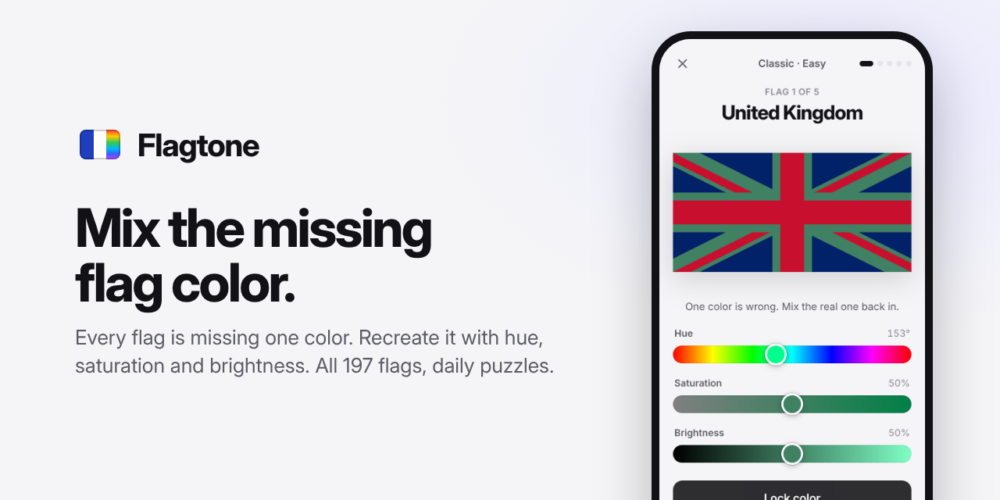

# Flagtone



Every flag is missing one color. Mix it back in with hue, saturation and brightness
sliders, and see how close you get.

- **Daily**: five flags, the same for everyone each day, from easy to impossible.
  Progress is saved, and finished days build a streak.
- **Classic**: five flags; your score is the average match.
- **Endless**: three hearts. A round under 70% costs a heart; a Perfect wins one back.
- **Time Attack**: 60 seconds. Great adds 3 seconds, Perfect adds 6; points grow
  with your combo.
- **Duel**: after a Classic game, send a friend a link. They get the same five flags
  with the same missing colors, and both scores are compared side by side. No
  account or server needed; everything travels in the link.

Free play draws its flags **by difficulty** (Easy, Medium, Hard, Impossible, from
household names to Pacific island states) or **by region** (Europe, Africa,
Americas, Asia, Oceania). Harder packs, region packs, long Endless runs and the
last Daily flags sometimes hide **two colors**; switch between them with tabs.

Great or better in a row builds a **combo**. Every flag you play joins your
**collection** with your best match, and 20 **badges** reward milestones. All of it
is kept in your browser.

Sound effects (synthesized, with a mute button), phone vibration and animations
make each round feel alive. Animations turn off when your device asks for reduced
motion. Light and dark themes follow your device.

## Rating

Each guess is compared with the real color by perceptual distance (CIEDE2000) and
shown as a match percentage:

| Grade | Match | Means |
|---|---|---|
| Perfect | 95%+ | Practically identical |
| Great | 85%+ | Hard to tell apart |
| Good | 70%+ | Close at a glance |
| Close | 50%+ | Right idea, visibly off |
| Off | under 50% | A different color |

After each flag, a short hint says what was off ("A bit too dark and slightly too
orange."), and three bars mark where your hue, saturation and brightness were
compared with the real color.

## Flags

All 197 sovereign states are bundled in [`flags/`](flags/README.md) at their
official proportions and colors. They come from Wikimedia Commons via
[hampusborgos/country-flags](https://github.com/hampusborgos/country-flags) and are
in the public domain. Everything is served with the game; the only outside request
is the Inter web font.

## Play it locally

It's a static site with no build step. ES modules need HTTP, so serve the folder:

```sh
npm start                      # http://127.0.0.1:8123/
python3 -m http.server 8123    # same thing, without Node
```

## Publish it on GitHub Pages

The game is plain files at the repository root, so GitHub can host it as is:

1. On GitHub, open the repository's **Settings → Pages**.
2. Under **Build and deployment**, set **Source** to **Deploy from a branch**, pick
   **master** and **/ (root)**, and save.
3. After a minute the game is live at `https://<your-user>.github.io/<repository>/`.

Every push to `master` updates it. To use the repository's social preview image,
upload `docs/social-card.png` under **Settings → General → Social preview**.

## Develop

```sh
npm test               # unit tests (Node's built-in runner)
npm run test:browser   # plays every mode in headless Chromium (needs Playwright)
npm run flags:data     # re-analyzes the flags into js/flagData.js (needs Playwright)
node dev/make-images.mjs   # redraws the app icons and the social card
```

GitHub Actions runs both test suites on every pull request.
`dev/check-flags.html` shows every flag with the colors the game may hide; add
`?audit` to also verify that hiding a color leaves no trace of it.

| File | What it does |
|---|---|
| `js/ui.js` | Screens and event wiring |
| `js/game.js` | Rules for one play-through (no DOM, no storage) |
| `js/rating.js` | Match %, grades and the "what was off" hint |
| `js/colors.js` | HSB/RGB/hex, CIELAB and CIEDE2000 |
| `js/records.js` | Best scores, stats, Daily progress, collection and badges in `localStorage` |
| `js/achievements.js` | Badge definitions and checks |
| `js/duel.js` | Encodes and checks duel links |
| `js/sound.js` | Synthesized sounds and vibration |
| `js/daily.js` | Date keys and the seeded Daily selection |
| `js/share.js` | Spoiler-free result text |
| `js/flagLoader.js` | Loads a flag SVG and repaints its hidden color |
| `js/flags.js` | Countries, difficulty tiers and regions |
| `js/flagData.js` | Generated: each flag's ratio and hideable colors |
| `js/flagAnalysis.js` | Dev only: finds hideable colors by rasterizing a flag |

## License

The code is [MIT](LICENSE). The flag artwork is in the public domain.
