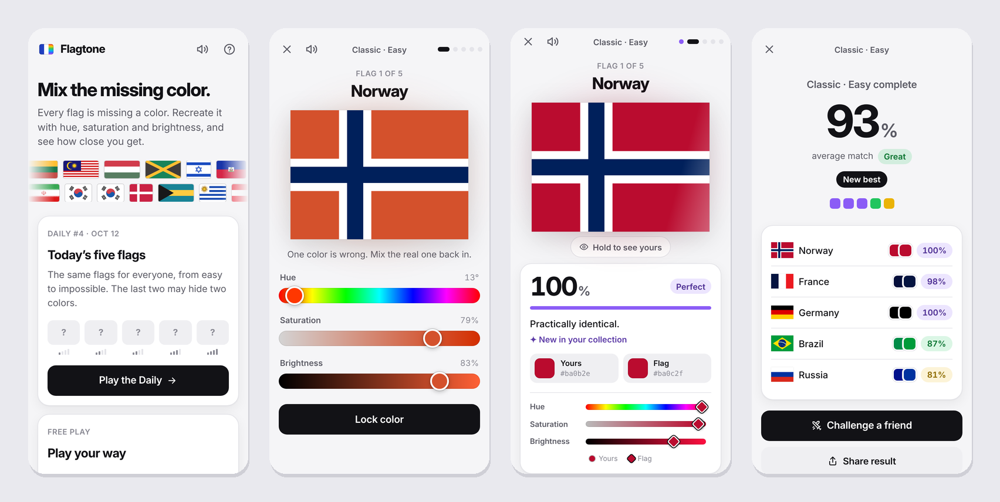

<h1 align="center">Flagtone</h1>

<p align="center">
  <strong>Every flag is missing a color. Mix it back in.</strong><br>
  A color-matching puzzle with all 197 flags of the world.
</p>

<p align="center">
  <a href="https://contrawr.github.io/Flagtone/"><strong>▶ Play Flagtone</strong></a>
  &nbsp;·&nbsp; free, no account, works on phone and desktop
</p>

<p align="center">
  
</p>

## How to play

1. A flag appears with one of its colors wrong. Its area blinks so you know where to look.
2. Mix the real color with three sliders: **hue**, **saturation** and **brightness**.
3. Lock it in. You'll see how close you got, as a percentage, with a tip on what was off
   ("A bit too dark and slightly too orange").

| Grade | Match | |
|---|---|---|
| 🟪 Perfect | 95%+ | Practically identical |
| 🟩 Great | 85%+ | Hard to tell apart |
| 🟨 Good | 70%+ | Close at a glance |
| 🟧 Close | 50%+ | Right idea, visibly off |
| 🟥 Off | under 50% | A different color |

Colors are compared the way eyes see them (CIEDE2000), not by their numbers, so a
slightly different shade of a dark navy and of a bright yellow count the same.

## Modes

| | |
|---|---|
| 📅 **Daily** | Five flags, the same for everyone, from easy to impossible. Build a streak. |
| 🎯 **Classic** | Five flags. Your score is the average match. |
| ❤️ **Endless** | Three hearts. Under 70% costs one, a Perfect wins one back. How far can you go? |
| ⏱️ **Time Attack** | 60 seconds. Great adds 3 s, Perfect adds 6 s, and combos multiply your points. |
| ⚔️ **Duel** | Finish a Classic game and send the link to a friend: same flags, same missing colors, scores side by side. |

Play flags **by difficulty**, from household names to Pacific island states, or
**by region**: Europe, Africa, Americas, Asia or Oceania. Harder rounds can hide
**two colors** at once.

## Also in the game

- 🔥 **Combos** for Great or better in a row
- 🗂️ A **collection** of every flag you've played, with your best match
- 🏅 **20 badges** to unlock
- 📤 **Sharing** as spoiler-free colored squares and a result picture
- 🔊 Sound effects and vibration, with a mute button
- 🌗 Light and dark themes that follow your device
- 🔒 No accounts, no ads, no tracking: your progress stays in your browser

## Flags

All 197 sovereign states are included at their official proportions and colors.
The artwork comes from Wikimedia Commons via
[hampusborgos/country-flags](https://github.com/hampusborgos/country-flags) and is
in the public domain. Everything ships with the game; the only outside request is
the Inter font.

## Run it yourself

Flagtone is a static website with no build step. Serve the folder over HTTP:

```sh
npm start                      # http://127.0.0.1:8123/
python3 -m http.server 8123    # same, without Node
```

### Publish on GitHub Pages

1. In the repository, open **Settings → Pages**.
2. Set **Source** to **Deploy from a branch**, pick **master** and **/ (root)**, and save.
3. A minute later the game is live at `https://<user>.github.io/<repository>/`.

Every push to `master` updates the site. Players keep their progress, since it is
stored in their browser rather than in the game files. If you fork or rename the
repository, update the preview links in `index.html` (`og:url`, `og:image`,
`twitter:image`).

## Develop

```sh
npm test               # unit tests (Node's built-in runner)
npm run test:browser   # plays every mode in headless Chromium (needs Playwright)
npm run flags:data     # re-analyzes the flags into js/flagData.js (needs Playwright)
node dev/make-images.mjs   # redraws the app icons and the social card
```

GitHub Actions runs both test suites on every pull request.
`dev/check-flags.html` shows every flag with the colors the game may hide; add
`?audit` to check that hiding a color leaves no trace of it.

<details>
<summary>Code map</summary>

| File | What it does |
|---|---|
| `js/ui.js` | Screens and event wiring |
| `js/game.js` | Rules for one play-through (no DOM, no storage) |
| `js/rating.js` | Match %, grades and the "what was off" hint |
| `js/colors.js` | HSB/RGB/hex, CIELAB and CIEDE2000 |
| `js/records.js` | Best scores, stats, Daily progress, collection and badges in `localStorage` |
| `js/achievements.js` | Badge definitions and checks |
| `js/duel.js` | Encodes and checks duel links |
| `js/daily.js` | Date keys and the seeded Daily selection |
| `js/share.js` | Spoiler-free result text |
| `js/shareCard.js` | Draws the result picture |
| `js/sound.js` | Synthesized sounds and vibration |
| `js/flagLoader.js` | Loads a flag SVG and repaints its hidden colors |
| `js/flags.js` | Countries, difficulty tiers and regions |
| `js/flagData.js` | Generated: each flag's ratio and hideable colors |
| `js/flagAnalysis.js` | Dev only: finds hideable colors by rasterizing a flag |

</details>

## License

The code is [MIT](LICENSE). The flag artwork is in the public domain.
